# Analisador e Gerador de Dados

**Relatório final do trabalho de Estatística**

| | |
|---|---|
| Disciplina | Estatística |
| Professor(a) | **[preencher]** |
| Turma | **[preencher]** |
| Integrantes | **[nome completo]** — matrícula **[preencher]**<br>**[nome completo]** — matrícula **[preencher]**<br>**[nome completo]** — matrícula **[preencher]**<br>**[nome completo]** — matrícula **[preencher]** |
| Data de entrega | 08/12/2026 |
| Versão do programa | 1.0.0 |

> Rascunho escrito a partir do programa entregue, para o grupo revisar. Os números citados vêm do arquivo de exemplo `pesquisa_saude.txt` e dos outros exemplos de `dados-exemplo/`, conferidos na tela e na API. Os campos **[preencher]** ficam com o grupo.

## Sumário

1. [Introdução](#1-introdução)
2. [Arquitetura e tecnologias](#2-arquitetura-e-tecnologias)
3. [Como usar](#3-como-usar)
4. [Leitura e classificação de tipos](#4-leitura-e-classificação-de-tipos)
5. [Limpeza](#5-limpeza)
6. [Análise univariada](#6-análise-univariada)
7. [Correlação e regressão](#7-correlação-e-regressão)
8. [Gerador de dados](#8-gerador-de-dados)
9. [Detector de dados artificiais](#9-detector-de-dados-artificiais)
10. [Relatório HTML](#10-relatório-html)
11. [Qualidade e testes](#11-qualidade-e-testes)
12. [Conclusão e limitações](#12-conclusão-e-limitações)
- [Referências](#referências)
- [Apêndice A — Fórmulas](#apêndice-a--fórmulas)
- [Apêndice B — Exemplo do relatório HTML](#apêndice-b--exemplo-do-relatório-html)

---

## 1. Introdução

### Objetivo

O enunciado pede um programa que leia um conjunto de dados, classifique cada coluna pelo tipo de variável e, a partir do tipo, escolha sozinho os cálculos e os gráficos; que limpe os dados, faça a análise descritiva completa (frequências, tendência central, separatrizes, dispersão, forma e distribuições), correlação e regressão; que gere dados artificiais parecidos com os originais; e que aponte suspeitas de dados artificiais, mostrando o que mediu e por que marcou.

O **Analisador e Gerador de Dados** faz isso numa aplicação web que roda no próprio computador, em 8 etapas: **Importar → Variáveis → Limpeza → Análise univariada → Bivariada → Gerador → Detector → Relatório**. Cada etapa explica o resultado em frases simples ("Lemos 230 linhas e 8 colunas."), e os detalhes técnicos — fórmula, cálculo com os números, teste e p-valor — ficam a um clique.

### O que o programa faz

| Item do enunciado | Onde está |
|---|---|
| Leitura de TXT, CSV, TSV, XLSX e JSON | Etapa 1 (seção 4) |
| Tipos de variável (nominal, ordinal, discreta, contínua, binária) | Etapa 2 (seção 4) |
| Limpeza: faltantes, duplicados, fora de faixa, consistência | Etapa 3 (seção 5) |
| Frequências, tendência central, separatrizes ("onde está meu valor"), dispersão | Etapa 4 (seção 6) |
| Gráficos escolhidos pelo tipo | Etapas 4 e 5 (seções 6 e 7) |
| Normal, Binomial, assimetria e curtose | Etapa 4, aba Forma (seção 6.5) |
| Correlação, regressão e previsão de Y por X | Etapa 5 (seção 7) |
| Gerador univariado e bivariado | Etapa 6 (seção 8) |
| Detector com resumo, o que mediu e por quê | Etapa 7 (seção 9) |
| Relatório com imagens e fórmulas | Etapa 8 (seção 10) e este documento |

### Arquivos usados

Os exemplos ficam em `dados-exemplo/` e abrem direto na tela Importar:

| Arquivo | Conteúdo | Para quê |
|---|---|---|
| `pesquisa_saude.txt` | 230 respostas de uma pesquisa de saúde: `id`, `sexo`, `idade`, `altura_m`, `peso_kg`, `escolaridade`, `cidade`, `satisfacao`; com faltantes, duplicados, valores fora de faixa e grafias diferentes | Exemplo principal: todos os tipos de variável e todos os problemas de limpeza |
| `alturas_reais.txt` | 400 pessoas (`id`, `altura_m`, `peso_kg`) sem manipulação | Mostrar que o detector fica quieto com dados reais |
| `alturas_plantadas.txt` | O mesmo conjunto com dados plantados e a coluna `cintura_cm` | Disparar as regras do detector |
| `vendas_correlacao_puxada.txt` | 120 semanas de anúncios e vendas, com a correlação puxada no fim e semanas copiadas | Regras de correlação por blocos e comparação no tempo |
| `notas_turma.csv` | Notas de uma turma (CSV com vírgula e ponto decimal) | Correlação e regressão com outro formato |

Os três arquivos do detector são gerados por `backend/scripts/gerar_exemplos_detector.py`, com semente fixa: rodar o script de novo refaz os mesmos arquivos.

## 2. Arquitetura e tecnologias

### Visão geral

```
Navegador (React + TypeScript)  ──HTTP/JSON──▶  API (FastAPI)  ──▶  núcleo estatístico (pandas, numpy, scipy)
        8 telas, gráficos Plotly                 6 domínios            figuras Plotly montadas no backend
```

- **Backend:** Python 3.12, FastAPI, pandas, numpy, scipy e plotly. Os dados ficam na memória do servidor, por sessão (ADR 0004): nada é gravado em disco nem enviado para fora.
- **Frontend:** React, Vite e TypeScript, com react-plotly.js para os gráficos e react-query para as chamadas à API.
- **Relatório:** HTML montado no backend com Jinja2, com Plotly e KaTeX (fórmulas).

### Camadas e domínios

O backend é um monólito em camadas, separado por domínio (ADR 0007): cada domínio tem `router.py` (HTTP, sem regra de negócio) → `servico.py` (casos de uso, a única porta de entrada do domínio) → módulos de domínio puros (recebem séries e tabelas, devolvem resultados imutáveis). Um domínio só conversa com outro pelo `servico.py` dele (ADR 0009), e um teste de arquitetura confere essas fronteiras.

| Domínio | Responsabilidade |
|---|---|
| `datasets` | Leitura dos arquivos, classificação de tipos, limpeza e estado em memória |
| `analise` | Frequências, tendência central, separatrizes, dispersão, forma, distribuições, correlação e regressão |
| `graficos` | Escolha do gráfico pelo tipo de variável e montagem das figuras Plotly (ADR 0003) |
| `gerador` | Estratégias de geração por tipo (univariado) e Cholesky (bivariado) |
| `detector` | As 11 regras, o registro delas e os textos dos alertas |
| `relatorio` | Montagem do relatório HTML e do apêndice de fórmulas |

O frontend segue a mesma ideia: uma pasta por etapa em `features/` e o que é comum (componentes, cliente da API, formatação de números em pt-BR) em `shared/`. Os tipos da API são gerados do OpenAPI do backend, então tela e servidor usam o mesmo contrato.

### Padrões de projeto

| Padrão | Onde | Por quê |
|---|---|---|
| Fachada | `servico.py` de cada domínio | Um ponto de entrada por domínio |
| Cadeia de responsabilidade | Classificação de tipos | Regras em ordem; a primeira que casa dá o tipo e o motivo |
| Strategy | Gerador (uma estratégia por tipo) | Sem `if tipo == …` espalhado |
| Registro e Template Method | Detector (`registro.py`, `regras/base.py`) | Uma regra nova = um arquivo; o fluxo "aplica-se? → mede → dispara? → textos" é o mesmo para as 11 |
| Fábrica | Gráficos | A regra "melhor gráfico por tipo" num lugar só |

### Decisões principais

As decisões ficam registradas em `docs/decisions.md` (uma linha cada) e as estruturais em ADRs (`docs/adr/`): arquitetura FastAPI + React (ADR 0001), núcleo estatístico sem framework (ADR 0002), figuras Plotly no backend (ADR 0003), estado em memória (ADR 0004), textos amigáveis com divulgação progressiva (ADR 0005), classificação automática de tipos (ADR 0006), monólito em camadas por domínio (ADR 0007), design system com variáveis CSS e tema claro/escuro (ADR 0008) e injeção de serviços entre domínios (ADR 0009). Convenções estatísticas: variância e desvio padrão amostrais (n − 1), separatrizes por interpolação linear, nível de significância de 5% na análise e de 1% no detector (para errar menos ao acusar).

## 3. Como usar

### Instalação

Requisitos: Python 3.12+ e Node 22+.

```bash
# terminal 1 — backend
cd backend
python -m venv .venv
.venv\Scripts\activate          # Linux/macOS: source .venv/bin/activate
pip install -e ".[dev]"
uvicorn app.main:app --reload   # API em http://localhost:8000/docs

# terminal 2 — frontend
cd frontend
npm install
npm run dev                     # aplicação em http://localhost:5173
```

### Fluxo das 8 etapas

1. **Importar:** arraste um arquivo ou clique em "Abrir pesquisa_saude.txt de exemplo". O programa detecta formato, separador, decimal, codificação e a linha do cabeçalho, e mostra o motivo de cada escolha; qualquer uma pode ser corrigida.
2. **Variáveis:** o tipo de cada coluna, com o motivo. O tipo pode ser trocado, e as análises seguintes se ajustam.
3. **Limpeza:** os problemas encontrados, com uma ação para cada (nada muda até "Aplicar limpeza"); o log diz o que foi feito e "Desfazer tudo" volta ao arquivo original.
4. **Análise univariada:** uma coluna por vez, em abas — Frequências, Tendência central, Separatrizes ("Onde está meu valor?"), Dispersão, Forma e distribuição, Gráficos.
5. **Bivariada:** duas colunas numéricas: correlação, reta de regressão, resíduos, matriz de correlação e "Prever Y para X".
6. **Gerador:** dados artificiais univariados ou em pares, com a tabela Original × Gerado.
7. **Detector:** os alertas das 11 regras, agrupados por coluna ou por regra.
8. **Relatório:** escolha de seções e colunas, prévia e "Baixar HTML" ou "Imprimir / salvar PDF".

A barra lateral mostra as etapas concluídas; a sessão fica salva no navegador, então recarregar a página não perde o trabalho (enquanto o servidor estiver aberto). O tema escuro fica no canto superior direito.

## 4. Leitura e classificação de tipos

### Leitura

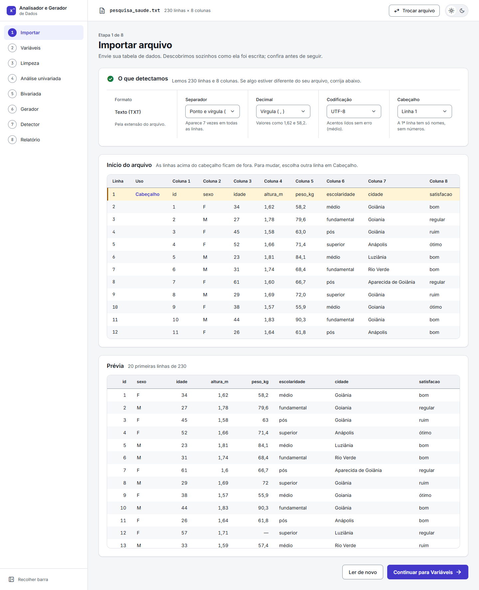

*Figura 1 — Importar: o que o programa detectou em `pesquisa_saude.txt` e o motivo de cada escolha.*

O programa lê TXT, CSV, TSV, XLSX e JSON. Em arquivos de texto, ele testa a codificação (UTF-8, UTF-8 com BOM, Windows-1252, Latin-1), o separador (o que aparece o mesmo número de vezes em todas as linhas), o decimal (vírgula ou ponto, pelos números encontrados) e a linha do cabeçalho (a primeira linha só com nomes). Em `pesquisa_saude.txt`: texto separado por ponto e vírgula ("Aparece 7 vezes em todas as linhas."), decimal com vírgula ("Valores como 1,62 e 58,2."), UTF-8 ("Acentos lidos sem erro (médio).") e cabeçalho na linha 1. Resultado: **230 linhas e 8 colunas**. No XLSX, a primeira aba é lida e o usuário pode escolher outra; no JSON, uma lista de registros (`[{…}]`) ou um objeto `{coluna: [valores]}` vira a tabela.

### Classificação de tipos

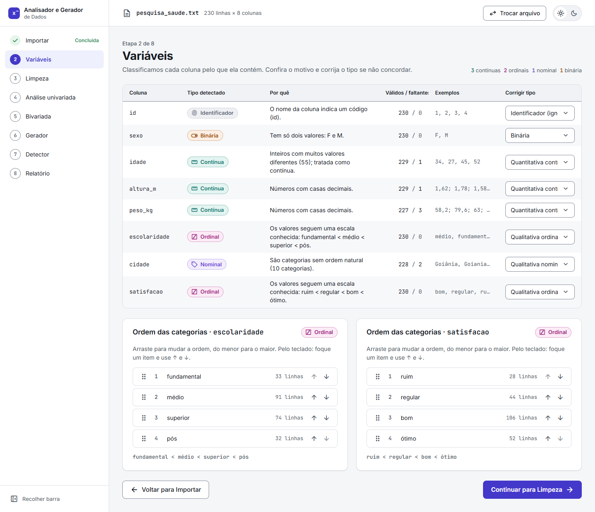

*Figura 2 — Variáveis: tipo de cada coluna, com o motivo.*

Cada coluna passa por regras em ordem; a primeira que casa decide o tipo e escreve o motivo (ADR 0006):

| # | Regra | Tipo |
|---|---|---|
| 0 | 90% ou mais dos valores no mesmo formato de data ou hora | data (fica fora das análises) |
| 1 | O nome indica um código (`id`, `cpf`, `matricula`…) ou, fora números com decimais, 95% ou mais dos valores são únicos (com 20 valores ou mais) | identificador (fora das análises) |
| 2 | Exatamente 2 valores diferentes | binária |
| 3 | Texto cujos valores estão numa escala conhecida (ruim < regular < bom < ótimo; fundamental < médio < superior < pós…) | qualitativa ordinal |
| 4 | Demais textos | qualitativa nominal |
| 5 | Números inteiros com até 30 valores diferentes | quantitativa discreta |
| 6 | Números com decimais, ou inteiros com mais de 30 valores diferentes | quantitativa contínua |

Uma coluna conta como numérica quando 90% ou mais dos valores viram número (os demais aparecem como "tipo misto" na limpeza); `R$` e `%` são aceitos. Por que essa ordem: uma data ou um código são números ou textos "de mentira" e precisam sair antes; com só dois valores, a coluna é binária mesmo que sejam números (0 e 1); entre os textos, a ordem natural só vale quando a escala é conhecida; entre os números, a contagem com poucos valores diferentes é discreta, e o resto é medida contínua.

Em `pesquisa_saude.txt`: `id` é identificador ("O nome da coluna indica um código (id)."), `sexo` é binária ("Tem só dois valores: F e M."), `idade` é contínua ("Inteiros com muitos valores diferentes (55); tratada como contínua."), `altura_m` e `peso_kg` são contínuas ("Números com casas decimais."), `escolaridade` e `satisfacao` são ordinais ("Os valores seguem uma escala conhecida: ruim < regular < bom < ótimo.") e `cidade` é nominal ("São categorias sem ordem natural (10 categorias)."). O tipo define o resto: média só para números, mediana também para ordinais, histograma para contínuas, barras para categorias.

## 5. Limpeza

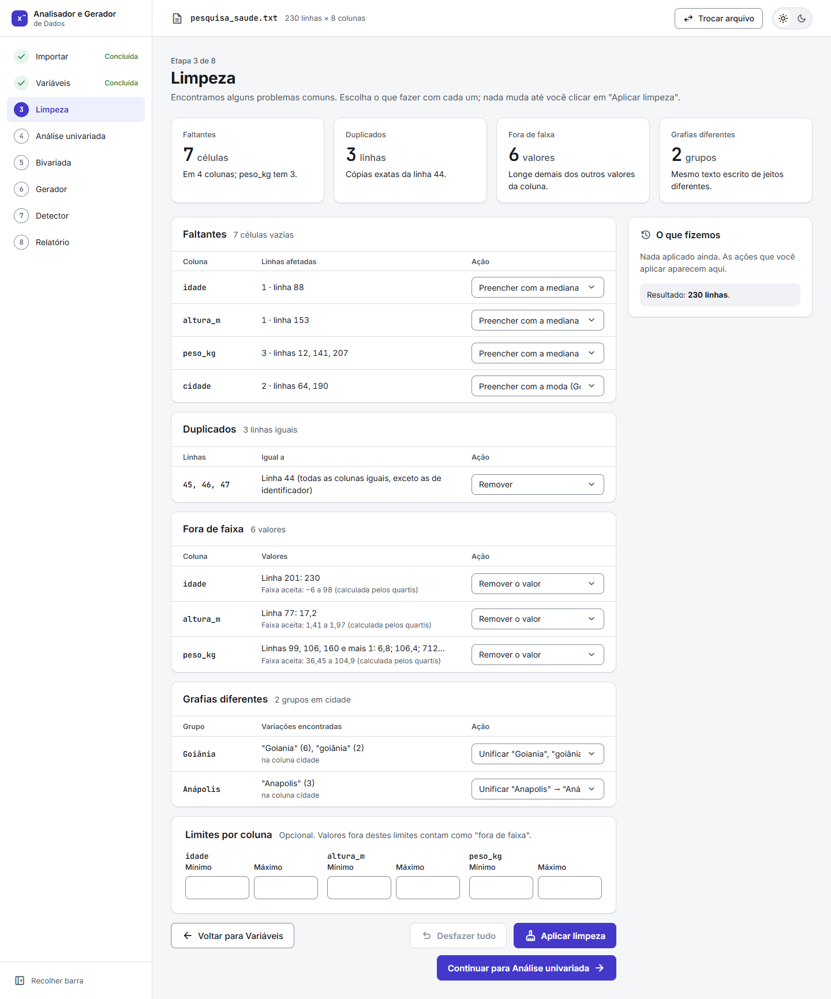

*Figura 3 — Limpeza: problemas encontrados e a ação escolhida para cada um.*

O diagnóstico não muda nada; ele aponta:

| Problema | Como é encontrado | Em `pesquisa_saude.txt` |
|---|---|---|
| Faltantes | Células vazias | `idade` 1 (linha 88), `altura_m` 1 (linha 153), `peso_kg` 3 (linhas 12, 141, 207), `cidade` 2 (linhas 64, 190) |
| Duplicados | Linhas iguais em todas as colunas, fora o identificador | Linha 44 repetida nas linhas 45, 46 e 47 |
| Fora de faixa | Fora de [Q1 − 1,5·IQR, Q3 + 1,5·IQR] ou dos limites que o usuário informar | `idade` 230 (faixa −6 a 98), `altura_m` 17,2 (1,41 a 1,97), `peso_kg` 6,8; 106,4; 712 e 109,4 (36,45 a 104,9) |
| Grafias diferentes | Mesmo texto depois de tirar acentos, maiúsculas e espaços | "Goiania" e "goiânia" → "Goiânia"; "Anapolis" → "Anápolis" |
| Tipo misto | Textos numa coluna numérica | Nenhum |

Para cada problema há ações: preencher com a média, a mediana ou a moda, remover a linha, manter; remover os duplicados; remover o valor, limitar à faixa ou remover a linha; unificar as grafias. A tela começa com tudo em "Manter" (o usuário decide). As ações são aplicadas nesta ordem: grafias → tipo misto → duplicados → fora de faixa → faltantes; assim, um valor fora de faixa removido ainda pode ser preenchido. O original nunca é alterado ("Desfazer tudo" volta a ele), e a média ou a mediana usadas no preenchimento entram nas casas decimais da coluna, para não mudar a precisão que o gerador e o detector leem.

Neste relatório, usamos a primeira opção de cada linha (mediana nos faltantes numéricos, moda em `cidade`, remover os duplicados, remover os valores fora de faixa e unificar as grafias). O log ficou assim: "Unificamos 8 grafias de cidade. Unificamos 3 grafias de cidade. Removemos 3 linhas duplicadas. Marcamos 1 valor de idade como faltante por estar fora da faixa. Marcamos 1 valor de altura_m como faltante por estar fora da faixa. Marcamos 4 valores de peso_kg como faltantes por estarem fora da faixa. Preenchemos 2 valores faltantes de idade com a mediana (46). Preenchemos 2 valores faltantes de altura_m com a mediana (1,68). Preenchemos 7 valores faltantes de peso_kg com a mediana (68,7). Preenchemos 2 valores faltantes de cidade com a moda (Goiânia)." Resultado: **227 linhas** (eram 230). Os números das seções seguintes são deste arquivo limpo.

> Observação para a apresentação: preencher 7 pesos com a mediana faz de 68,7 a moda de `peso_kg` (9 vezes). É um efeito conhecido da imputação pela mediana e um bom exemplo de que a limpeza também muda as medidas.

## 6. Análise univariada

A tela mostra uma coluna por vez. As abas que não se aplicam ao tipo ficam desabilitadas, com o motivo ("Média não se aplica a qualitativas nominais…"). Os exemplos abaixo são de `peso_kg` (contínua, n = 227).

### 6.1 Frequências

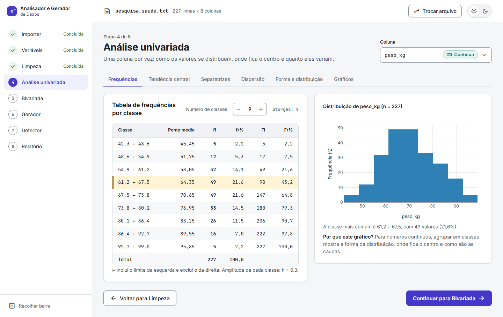

*Figura 4 — Frequências de `peso_kg`: tabela por classes e histograma.*

Para variáveis contínuas, os valores são agrupados em classes de mesma amplitude. O número de classes vem da regra de Sturges e a amplitude da classe divide a amplitude total:

$$
k = \lceil 1 + 3{,}322 \log_{10} n \rceil \qquad h = \frac{x_{max} - x_{min}}{k}
$$

Com n = 227, k = 9 classes de amplitude 6,3 (de 42,3 a 99,0). A tabela traz a frequência absoluta fᵢ, a relativa frᵢ = fᵢ/n e a acumulada Fᵢ:

| Classe | fᵢ | fr% | Fr% |
|---|---|---|---|
| 42,3 ⊢ 48,6 | 5 | 2,2% | 2,2% |
| 48,6 ⊢ 54,9 | 12 | 5,3% | 7,5% |
| 54,9 ⊢ 61,2 | 32 | 14,1% | 21,6% |
| 61,2 ⊢ 67,5 | 49 | 21,6% | 43,2% |
| 67,5 ⊢ 73,8 | 49 | 21,6% | 64,8% |
| 73,8 ⊢ 80,1 | 33 | 14,5% | 79,3% |
| 80,1 ⊢ 86,4 | 26 | 11,5% | 90,7% |
| 86,4 ⊢ 92,7 | 16 | 7,0% | 97,8% |
| 92,7 ⊢ 99,0 | 5 | 2,2% | 100,0% |

Discretas usam um valor por linha; nominais, uma categoria por linha, sem acumulada (não há ordem); ordinais seguem a ordem da escala. O usuário pode mudar o número de classes.

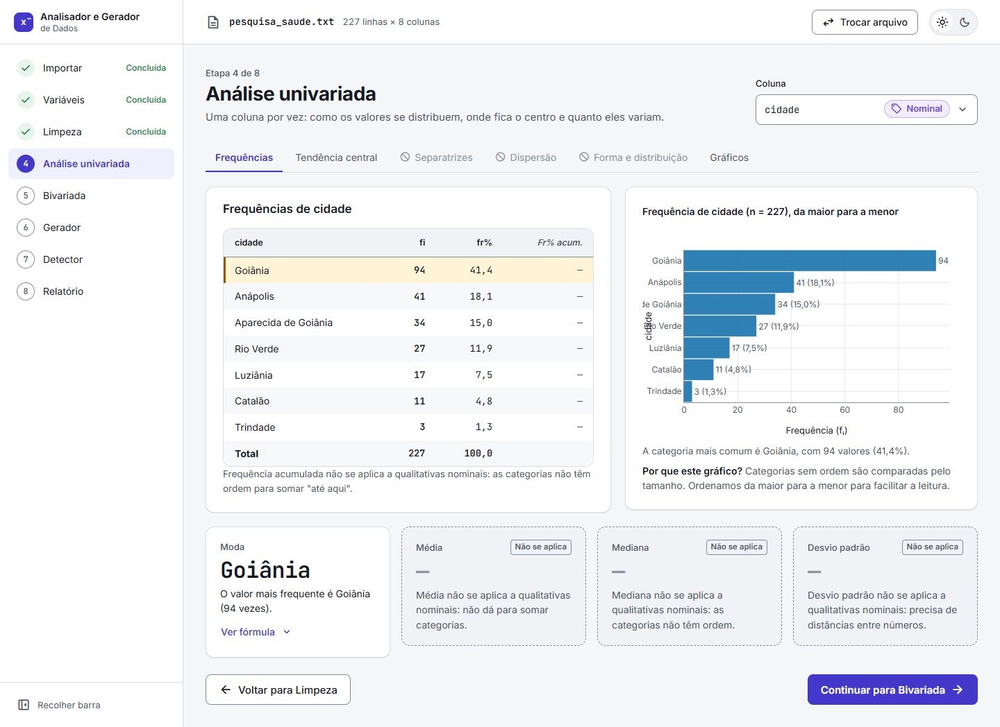

*Figura 5 — `cidade`, nominal: frequências em barras ordenadas e as medidas que não se aplicam, com o motivo.*

Em `cidade`, depois de unificar as grafias, ficam 7 categorias; a moda é Goiânia (94 respostas, 41,4%).

### 6.2 Tendência central


*Figura 6 — Tendência central de `peso_kg`, com o cálculo de cada medida.*

$$
\bar{x} = \frac{\sum x_i}{n} \qquad Md = x_{\left(\frac{n+1}{2}\right)} \qquad Mo = L_i + \frac{\Delta_1}{\Delta_1 + \Delta_2} \cdot h \ \text{(Czuber)}
$$

Em `peso_kg`: **média 70,11** (Σxᵢ / n = 15.915 / 227), **mediana 68,7** (posição 114), **moda 68,7** (9 vezes) e moda de Czuber 67,5 (pela classe modal 61,2 ⊢ 67,5). Média maior que a mediana indica valores altos puxando a média (cauda à direita). A moda de Czuber estima a moda de dados agrupados; para binárias, a tela mostra a proporção (em `sexo`, p̂ = 0,4978 para "F"); para ordinais, mediana e moda pela escala (em `satisfacao`, mediana e moda "bom").

### 6.3 Separatrizes e "Onde está meu valor?"

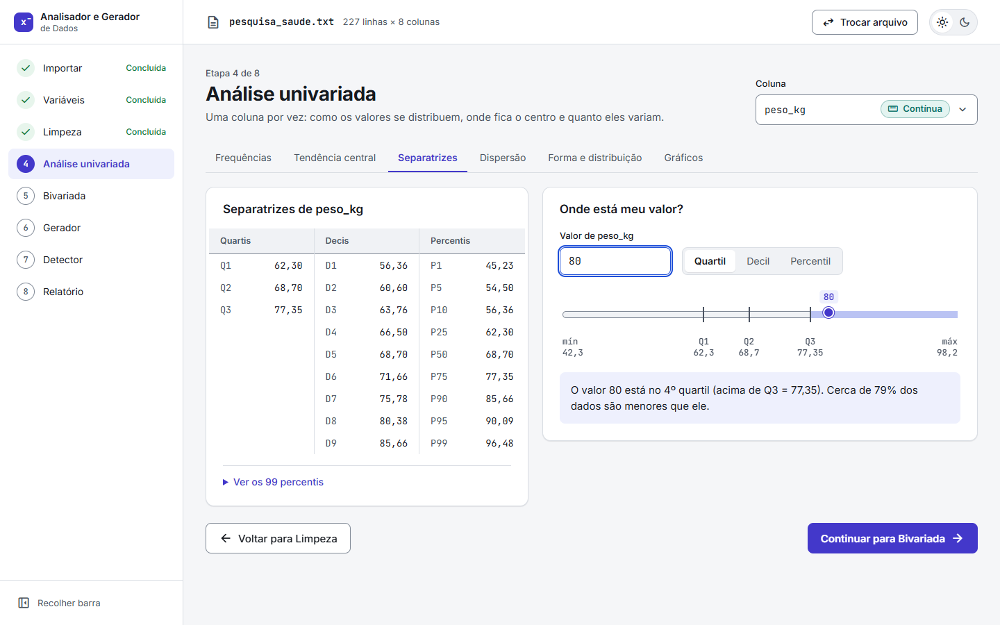

*Figura 7 — Quartis, decis e percentis de `peso_kg`, e a posição do valor 80.*

As separatrizes usam interpolação linear entre os valores ordenados (o método `linear` do numpy):

$$
Q_p = x_{(\lfloor h \rfloor)} + (h - \lfloor h \rfloor)\left(x_{(\lfloor h \rfloor + 1)} - x_{(\lfloor h \rfloor)}\right),\quad h = (n - 1)\,p
$$

Em `peso_kg`: Q1 = 62,3 · Q2 = 68,7 · Q3 = 77,35; D1 = 56,36 · D9 = 85,66; P5 = 54,5 · P95 = 90,09. A tabela mostra os 9 decis e os percentis principais, e "Ver os 99 percentis" abre todos.

**"Onde está meu valor?"** O usuário digita um valor e escolhe quartil, decil ou percentil. O programa diz a região e a posição percentil:

$$
PR = 100 \cdot \frac{\#(x_i < v) + 0{,}5 \cdot \#(x_i = v)}{n}
$$

Com v = 80: "O valor 80 está no 4º quartil (acima de Q3 = 77,35). Cerca de 79% dos dados são menores que ele." Valores fora da faixa dos dados recebem um aviso.

### 6.4 Dispersão

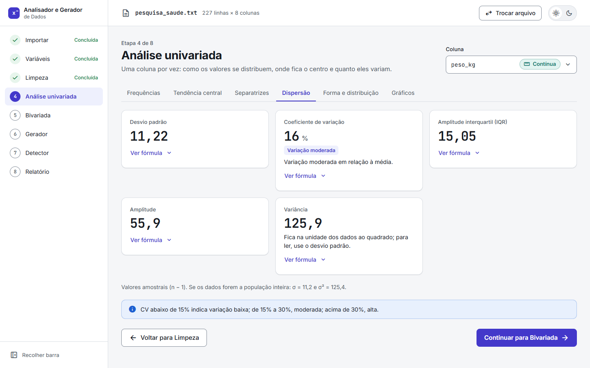

*Figura 8 — Medidas de dispersão de `peso_kg`.*

$$
A = x_{max} - x_{min} \qquad s^2 = \frac{\sum (x_i - \bar{x})^2}{n - 1} \qquad s = \sqrt{s^2} \qquad IQR = Q_3 - Q_1 \qquad CV = \frac{s}{\bar{x}} \cdot 100\%
$$

Em `peso_kg`: amplitude 55,9 (98,2 − 42,3), variância 125,9 (amostral; a populacional, 125,4, aparece ao lado), **desvio padrão 11,22**, amplitude interquartil (IQR) 15,05 e **coeficiente de variação 16,01%** ("Variação moderada em relação à média"). Para comparar: `altura_m` tem CV 5,49% (homogênea) e `idade`, 34,41% (heterogênea). Em ordinais, a amplitude e o IQR saem em categorias (em `satisfacao`, IQR "de regular a bom").

### 6.5 Forma e distribuições


*Figura 9 — Assimetria, curtose, ajuste à Normal, histograma com a curva e QQ-plot de `peso_kg`.*

**Assimetria e curtose.** Usamos os coeficientes amostrais de Fisher (G₁ e G₂, os mesmos de Excel e SAS), com os de Pearson e a curtose percentílica ao lado:

$$
G_1 = \frac{\sqrt{n(n-1)}}{n-2} \cdot \frac{m_3}{m_2^{3/2}},\quad m_k = \frac{\sum (x_i - \bar{x})^k}{n} \qquad As_1 = \frac{\bar{x} - Mo}{s} \qquad As_2 = \frac{3(\bar{x} - Md)}{s} \qquad K = \frac{Q_3 - Q_1}{2(P_{90} - P_{10})}
$$

G₂ é o excesso de curtose (na Normal, G₂ = 0). A classificação segue faixas: |G₁| < 0,5 é aproximadamente simétrica, de 0,5 a 1 é moderada e acima de 1 é forte (sinal positivo: cauda à direita); |G₂| < 0,5 é mesocúrtica, abaixo de −0,5 é platicúrtica (achatada) e acima de 0,5 é leptocúrtica (pico alto, caudas pesadas). Em `peso_kg`: G₁ = 0,2127 (aproximadamente simétrica, cauda direita um pouco mais longa), G₂ = −0,314 (mesocúrtica), As₁ = 0,2327, As₂ = 0,3773 e K = 0,2568 (na Normal, K ≈ 0,263).

**Normal.** A curva usa a média e o desvio da coluna:

$$
f(x) = \frac{1}{\sigma\sqrt{2\pi}}\, e^{-\frac{(x-\mu)^2}{2\sigma^2}}
$$

A aderência é testada com Shapiro-Wilk (até 5.000 valores; acima, D'Agostino-Pearson) e conferida com o qui-quadrado nas classes. Em `peso_kg`: "Shapiro-Wilk: W = 0,9898 · p = 0,111 ≥ 0,05. Os dados são compatíveis com a distribuição Normal." (qui-quadrado: χ² = 4,94, gl = 6, p = 0,551). Em `idade`, p < 0,001: os dados se afastam da Normal (distribuição platicúrtica, G₂ = −0,98). O QQ-plot mostra o mesmo em figura: pontos perto da reta indicam Normal.

**Binomial e Bernoulli.** Para variáveis discretas de contagem (inteiros ≥ 0), o programa ajusta a Binomial com n tentativas (padrão: o maior valor observado, que o usuário pode mudar) e p̂ = x̄ / n, e compara observado × esperado com o qui-quadrado:

$$
P(X = k) = \binom{n}{k} p^k (1-p)^{n-k}
$$

Para binárias, a distribuição é a Bernoulli (em `sexo`, p̂ = 0,4978 e Var = p(1 − p) = 0,25). Contínuas e qualitativas mostram o motivo de não se aplicar ("Binomial não se aplica a quantitativas contínuas: precisa de contagens de sucessos em n tentativas.").

### 6.6 Gráficos por tipo

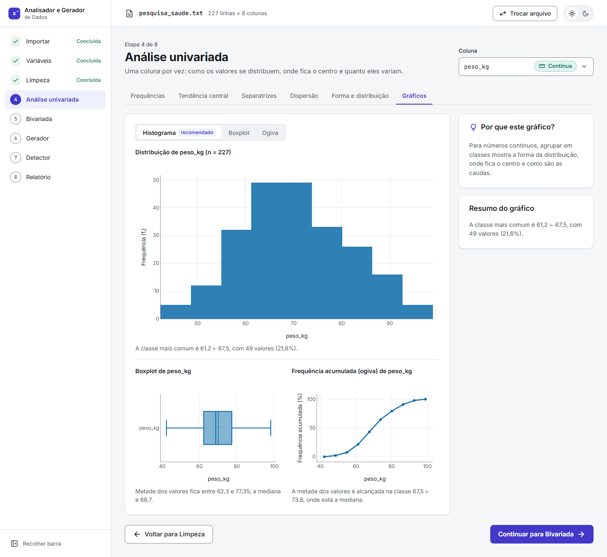

*Figura 10 — Gráficos de `peso_kg`, com o principal marcado e o motivo da escolha.*

| Tipo | Gráfico principal | Outros |
|---|---|---|
| Contínua | Histograma | Boxplot, ogiva (frequência acumulada) |
| Discreta | Gráfico de bastões | Boxplot, frequência acumulada em escada |
| Binária | Barras com as duas proporções | — |
| Nominal | Barras horizontais ordenadas da maior para a menor | Setores (pizza), só com até 5 categorias |
| Ordinal | Barras na ordem da escala | Barras da frequência acumulada |

Cada gráfico tem um resumo em texto ("A classe mais comum é 61,2 ⊢ 67,5, com 49 valores (21,6%).") e um "Por que este gráfico?". As figuras são montadas no backend (ADR 0003), então a tela e o relatório mostram exatamente o mesmo gráfico.

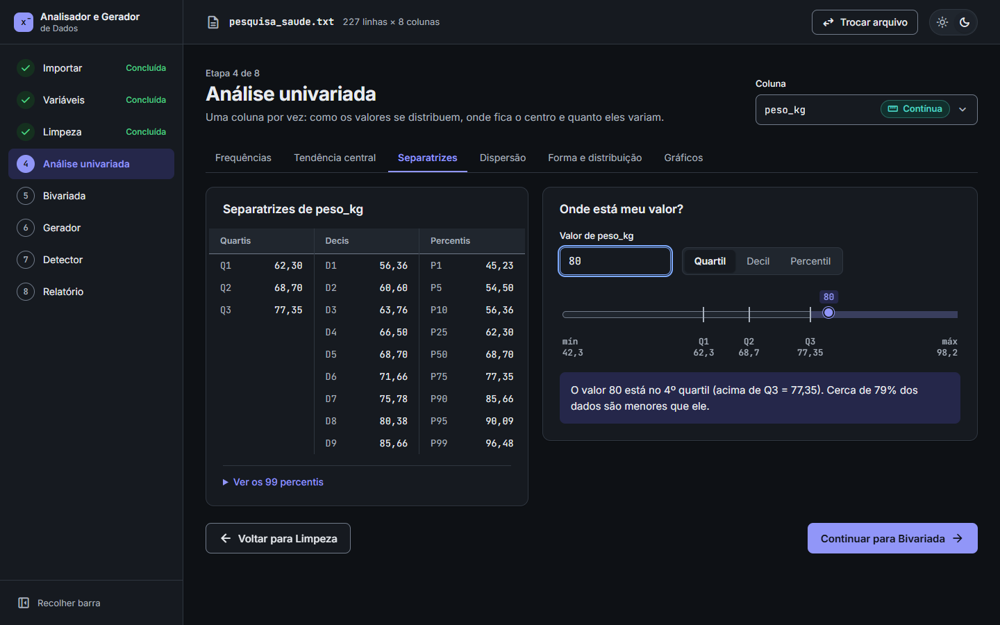

*Figura 11 — A mesma tela no tema escuro.*

## 7. Correlação e regressão

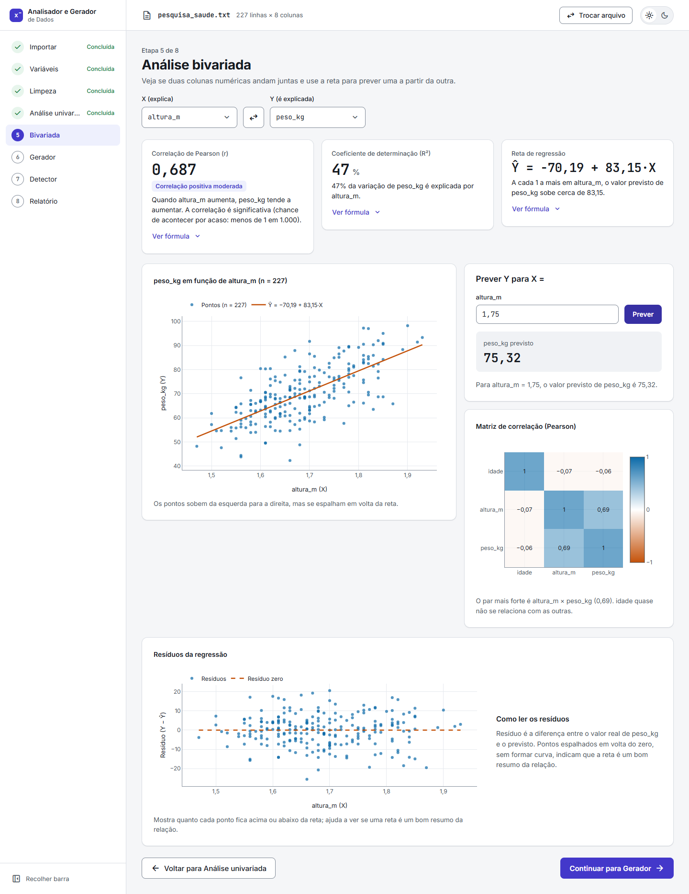

*Figura 12 — Bivariada: correlação, reta, previsão para 1,75 m, matriz de correlação e resíduos.*

A tela abre no par de colunas numéricas com a correlação mais forte. Em `pesquisa_saude.txt`, a matriz mostra que o par é `altura_m` × `peso_kg` (0,69) e que `idade` quase não se relaciona com as outras (−0,07 e −0,06).

**Correlação de Pearson**, com o teste t de significância, e **Spearman** (Pearson dos postos, útil com valores extremos ou relação que não é uma reta):

$$
r = \frac{\sum (x_i - \bar{x})(y_i - \bar{y})}{\sqrt{\sum (x_i - \bar{x})^2 \sum (y_i - \bar{y})^2}} \qquad t = \frac{r\sqrt{n-2}}{\sqrt{1 - r^2}},\ gl = n - 2
$$

Em altura_m × peso_kg: **r = 0,6869** (correlação positiva moderada), t = 14,18 com gl = 225 (p < 0,001: "A correlação é significativa (chance de acontecer por acaso: menos de 1 em 1.000)") e ρ de Spearman = 0,6695.

**Regressão linear simples** por mínimos quadrados:

$$
\hat{Y} = a + bX,\quad b = \frac{\sum (x_i - \bar{x})(y_i - \bar{y})}{\sum (x_i - \bar{x})^2},\quad a = \bar{y} - b\bar{x} \qquad R^2 = r^2 \qquad S_e = \sqrt{\frac{\sum (y_i - \hat{y}_i)^2}{n - 2}}
$$

Resultado: **Ŷ = −70,19 + 83,15·X** ("A cada 1 a mais em altura_m, o valor previsto de peso_kg sobe cerca de 83,15"), **R² = 47%** ("47% da variação de peso_kg é explicada por altura_m") e Sₑ = 8,174 kg. O gráfico de resíduos (eᵢ = yᵢ − ŷᵢ) mostra pontos espalhados em volta do zero, sem formar curva: a reta é um bom resumo da relação.

**Prever Y para X:** com altura_m = 1,75, "o valor previsto de peso_kg é 75,32". Fora da faixa observada de X (1,47 a 1,93), a tela avisa que é uma extrapolação.

## 8. Gerador de dados

O gerador cria dados artificiais a partir de uma coluna (preservando as estatísticas dela) ou de parâmetros informados. Toda geração tem uma **semente**: a mesma semente repete o mesmo resultado (`numpy.random.default_rng`). O resultado vem com a tabela **Original × Gerado**, um gráfico, a explicação do método em linguagem simples e três saídas: "Baixar CSV", "Anexar ao arquivo atual" e "Usar como novo arquivo".

### 8.1 Univariado

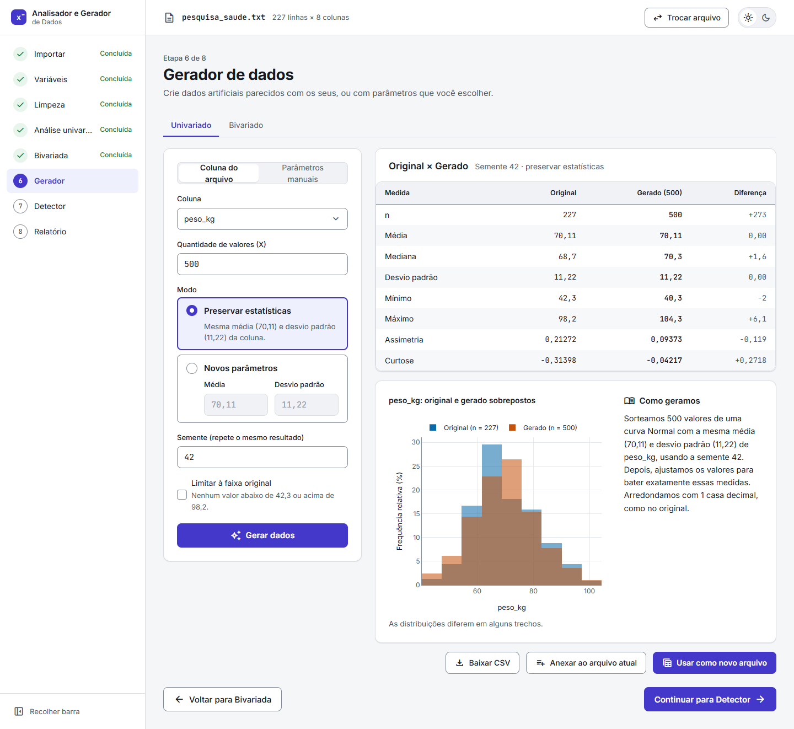

*Figura 13 — 500 valores de `peso_kg` preservando as estatísticas (semente 42).*

O método depende do tipo da coluna:

| Tipo | Preservar estatísticas | Novos parâmetros |
|---|---|---|
| Contínua | Normal(x̄, s) se a coluna adere à Normal (p ≥ 0,05); senão KDE (densidade por núcleo, banda de Scott). Depois, **reescala exata** | Normal(média, desvio) + reescala |
| Discreta | Poisson(x̄) se média e variância são parecidas (\|x̄ − s²\| / x̄ < 0,2); senão sorteio com as frequências observadas | Normal arredondada, sem negativos se o original não tinha |
| Binária | Bernoulli(p̂) com os mesmos rótulos | Bernoulli(p informado) |
| Nominal e ordinal | Sorteio com as frequências relativas observadas | — |

**Reescala exata.** Os valores sorteados têm média e desvio parecidos, mas não iguais aos pedidos. A reescala os padroniza e os leva exatamente para a média x̄ e o desvio s alvo; depois, arredonda nas casas decimais do original:

$$
z_i = \frac{g_i - \bar{g}}{s_g},\quad x_i' = \bar{x} + s \cdot z_i
$$

**Limitar à faixa** (opcional): valores fora do mínimo e do máximo do original são sorteados de novo e a reescala é refeita, até 20 rodadas; o que sobrar é cortado no limite.

Exemplo (Figura 13): `peso_kg` adere à Normal (p = 0,111), então o método é "Normal com reescala": "Sorteamos 500 valores de uma curva Normal com a mesma média (70,11) e desvio padrão (11,22) de peso_kg, usando a semente 42. Depois, ajustamos os valores para bater exatamente essas medidas. Arredondamos com 1 casa decimal, como no original."

| Medida | Original (227) | Gerado (500) | Diferença |
|---|---|---|---|
| Média | 70,11 | 70,11 | 0,00 |
| Desvio padrão | 11,22 | 11,22 | 0,00 |
| Mediana | 68,7 | 70,3 | +1,6 |
| Mínimo | 42,3 | 40,3 | −2 |
| Máximo | 98,2 | 104,3 | +6,1 |
| Assimetria | 0,2127 | 0,0937 | −0,119 |
| Curtose | −0,314 | −0,0422 | +0,272 |

Média e desvio ficam iguais (a reescala garante); mediana, extremos e forma variam como numa amostra real da Normal — dados realistas, não uma cópia.

### 8.2 Bivariado

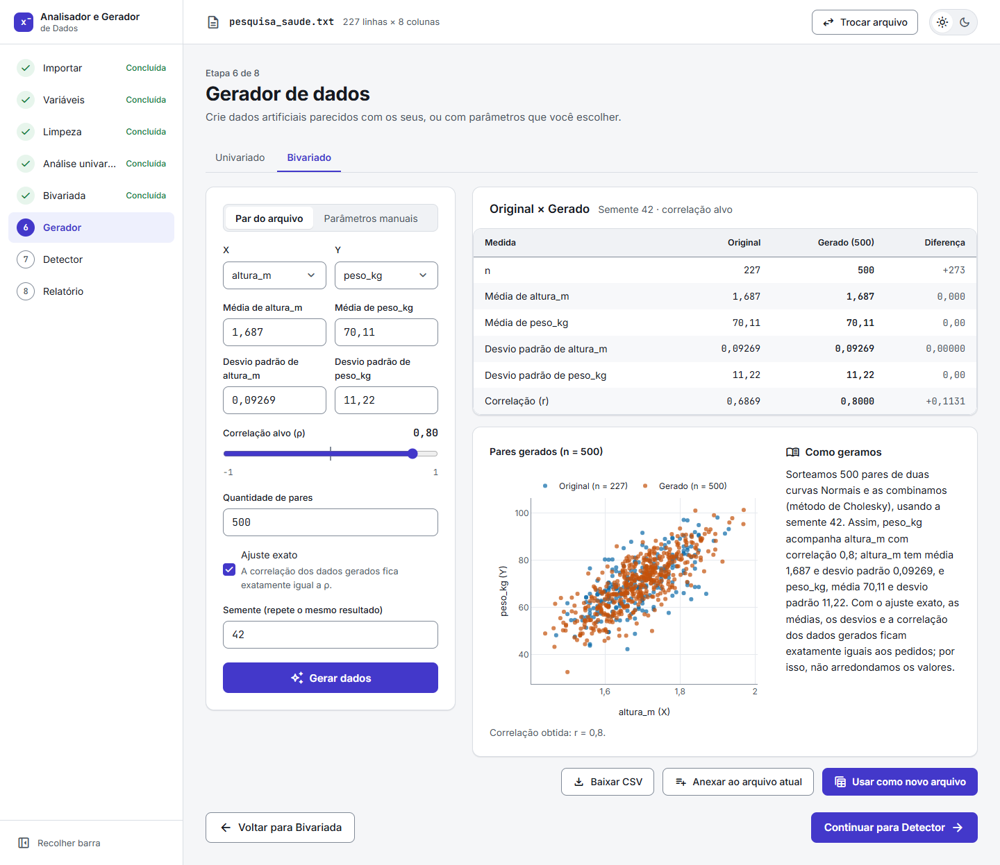

*Figura 14 — 500 pares de `altura_m` × `peso_kg` com correlação alvo ρ = 0,8 (semente 42).*

O bivariado gera pares com médias, desvios e correlação alvo pelo **método de Cholesky**: a matriz de covariância alvo Σ = [[σx², ρσxσy], [ρσxσy, σy²]] é decomposta em L·Lᵀ, e duas Normais padrão independentes Z₁ e Z₂ viram:

$$
X = \mu_x + \sigma_x Z_1 \qquad Y = \mu_y + \sigma_y\left(\rho Z_1 + \sqrt{1 - \rho^2}\, Z_2\right)
$$

Com o **ajuste exato** (padrão), Z₁ e Z₂ são antes centradas e ortonormalizadas (Gram-Schmidt), para que a correlação amostral entre elas seja 0 e os desvios sejam 1; assim a correlação dos pares gerados sai exatamente igual a ρ:

$$
Z_2' = Z_2 - \frac{Z_2 \cdot Z_1}{Z_1 \cdot Z_1}\, Z_1
$$

Exemplo (Figura 14): com as médias e os desvios de altura_m e peso_kg e ρ = 0,8, os 500 pares têm média 1,687 e 70,11, desvios 0,09269 e 11,22 e **r = 0,8000** (o original tem 0,6869). Com o ajuste exato, os valores não são arredondados (arredondar desfaria a exatidão); sem ele, r fica perto de ρ (variação amostral).

### 8.3 Tolerâncias testadas

Os testes automáticos conferem: média e desvio gerados dentro de 1% do alvo (com a reescala, iguais); bivariado com ajuste exato com |r − ρ| < 10⁻⁹; sem ajuste, com 10.000 pares, |r − ρ| < 0,03; mesma semente → mesmo resultado; e o gráfico de sobreposição leve mesmo com 1.000.000 de valores.

## 9. Detector de dados artificiais

### 9.1 Como funciona


*Figura 15 — Detector em `alturas_plantadas.txt`: resumo por severidade e alertas por coluna.*

O detector roda 11 regras sobre a versão atual do arquivo. Cada alerta tem 8 partes, na ordem da tela: selo de severidade, título, resumo, **por que chama atenção**, **pode ser normal se…**, exemplo (as linhas e os valores), **o que fazer** e os **detalhes técnicos** (medida, valor, limiar, teste, p-valor traduzido em palavras e fórmula). "Ver na tabela" abre as linhas do alerta destacadas, com 3 linhas de contexto, e permite exportá-las. As regras que não se aplicam aparecem em "Regras não verificadas", com o motivo.

Três severidades: **suspeita alta** (padrão muito improvável em dados reais), **atenção** (vale conferir) e **informativo** (pode ser normal, mas o usuário deve saber). Um alerta pede conferência, não é uma conclusão.

O princípio de todas as regras é **comparar com o acaso**: um padrão só vira alerta quando é improvável em dados reais (p < 0,01, mais exigente que os 5% da análise, para errar menos ao acusar). Quando não há fórmula fechada para o acaso, a regra o simula: a R1, por exemplo, embaralha a coluna 1.000 vezes.

### 9.2 As 11 regras

As 6 ideias do enunciado são as regras R1, R2, R3, R4, R5 e R6; a R7 informa os valores distantes (outliers), também pedidos; R8 a R11 são as ideias a mais.

| Regra | O que mede | Dispara quando | Severidade | Pode ser normal se… |
|---|---|---|---|---|
| R1 · Bloco alinhado | Trechos de k = max(10, ⌊n/20⌋) linhas seguidas e o fim do arquivo (10 a ⌊n/2⌋ linhas): diferença de média (dᵤ) e de desvio (dₛ) para o restante, em desvios do restante | dᵤ e dₛ < 0,01 e menos de 1% de 1.000 embaralhamentos com um trecho tão parecido | alta | …o conjunto foi ordenado ou amostrado de forma sistemática |
| R2 · Correlação por blocos | r geral, r em 5 blocos seguidos e r sem cada bloco | \|r\| passa a média dos blocos em mais de 0,3, ou tirar um bloco baixa \|r\| em mais de 0,3 | alta (atenção numa série no tempo) | …os blocos têm faixas de valores muito diferentes |
| R3 · Formato numérico | % de valores com decimais e posição dos inteiros | ≥ 80% com decimais e inteiros agrupados (≥ 5 seguidos) ou a passo constante, improváveis ao acaso (Poisson, p < 0,01) | atenção | …parte dos dados veio de outro instrumento |
| R4 · Valores redondos | % de valores terminados em 0 ou 5 (esperado 20%) e em 0 (10%), na precisão da coluna | Binomial unilateral p < 0,01 e pelo menos 1,5× o esperado | atenção | …o instrumento só mede de 5 em 5 |
| R5 · Duplicatas | Linhas iguais e quase iguais (distância padronizada < 0,01·√p) | Mais repetições que o acaso (Poisson, p < 0,01); alta com 3 linhas iguais seguidas | atenção / alta | …são registros legítimos repetidos |
| R6 · Comparação temporal | Antes × depois da data do meio: desvio de cada coluna e linhas novas iguais a antigas | Desvio cai para menos da metade (F, p < 0,01), ou ≥ 10% das linhas novas copiam antigas além do acaso (binomial, p < 0,01) | alta | …houve mudança real no processo |
| R7 · Valores distantes | Cercas de Tukey (1,5·IQR e 3·IQR), alargadas na cauda longa (boxplot ajustado), e \|z\| > 3 | Existir valor fora | informativo (atenção com extremo) | …são casos raros, mas reais |
| R8 · Lei de Benford | Frequência do 1º dígito × P(d) = log₁₀(1 + 1/d); χ² e MAD | p < 0,01 e MAD > 0,015 (não conformidade de Nigrini) | atenção | …os dados têm faixa limitada (idades, notas) |
| R9 · Último dígito | Frequência do último dígito (esperado 10% cada); χ² | p < 0,01 e o dígito mais comum com ≥ 15% | atenção | …são preços (5,99) ou o instrumento arredonda |
| R10 · Normal perfeita demais | G₁, G₂ e o p do teste de normalidade | \|G₁\| < 0,05, \|G₂\| < 0,1 e p > 0,99, com n ≥ 200 | informativo | …a amostra é grande e o fenômeno é Normal |
| R11 · Sequência | Ordem dos valores: sequências acima/abaixo da mediana (runs), progressões aritméticas e autocorrelação | Runs p < 0,01, progressão improvável ao acaso ou \|ρ₁\| > 0,8 | atenção (informativo numa série no tempo) | …os dados estão ordenados por tempo ou por outra coluna |

Fórmulas principais (todas no Apêndice A):

$$
d_\mu = \frac{|\bar{x}_{bloco} - \bar{x}_{resto}|}{s_{resto}} \qquad d_s = \frac{|s_{bloco} - s_{resto}|}{s_{resto}} \qquad P(d) = \log_{10}\left(1 + \frac{1}{d}\right) \qquad \chi^2 = \sum \frac{(O_i - E_i)^2}{E_i}
$$

**Por que a R1 compara com o restante, e não com o conjunto todo.** O caso a pegar é exatamente o do Gerador: gerar k valores com a média e o desvio de uma coluna e anexá-los a ela. O bloco tem as estatísticas do restante, mas não as do conjunto (o desvio do conjunto cai um pouco quando o bloco entra). Comparando com o restante, o bloco fica a distância zero e a regra dispara em 20 de 20 sementes; comparando com o conjunto, disparava em só 8 de 20.

**Limiar ajustado ao tipo de dado.** Várias regras ignoram o que é natural: R4 e R9 tiram os zeros ("nada medido") e só se aplicam quando o último dígito pode ser aleatório (não em notas de 0 a 10); a R7 alarga a cerca do lado da cauda longa (boxplot ajustado de Hubert e Vandervieren, pelo medcouple): em amostras Exponenciais de 300 valores, as que tinham algum valor "extremo" caíram de 92,5% para 4%, e erros de digitação (×10) continuam extremos; a R8 não conta valores perto do passo do instrumento.

### 9.3 Controle de alertas falsos

Um teste automático gera 100 amostras Normais (média 50, desvio 10) e 100 Exponenciais (média 10), com 500 valores cada e 2 casas decimais, e roda as 11 regras. **Cada regra dispara em menos de 5% das amostras** (exceto a R7, que é informativa). Taxas obtidas: R11 1% nas duas famílias; R1 1% nas Normais e 2% nas Exponenciais; R8 2% nas Exponenciais; as demais, 0%. O teste roda no CI a cada mudança: uma regra nova ou ajustada não pode aumentar os alertas falsos.

### 9.4 Dados plantados e o que cada arquivo dispara

| Arquivo | O que foi plantado | O que o detector mostra |
|---|---|---|
| `alturas_reais.txt` | Nada | **Nenhum alerta** (9 regras verificadas, 2 não se aplicam: não há data; Benford precisa de várias ordens de grandeza) |
| `alturas_plantadas.txt` | Linhas 181–200 com pesos de média e desvio do restante | R1, suspeita alta: "Linhas 181 a 200: média 71,26 (restante 71,26) · desvio padrão 12,01 (restante 12,01)" (p = 0) |
| | Linhas 61–70 com pesos inteiros | R3, atenção: "86% dos valores têm casas decimais, mas 10 inteiros aparecem juntos (linhas 61–70)" |
| | Linhas 301–380 com alturas de 5 em 5 cm | R4, atenção: "34% dos valores terminam em 0 ou 5; … o esperado seria cerca de 20%"; e R9: "o 0 aparece 19% das vezes" |
| | A mesma linha 4 vezes seguidas | R5, suspeita alta: "as linhas 283 a 286 são iguais e seguidas" |
| | `cintura_cm` tirada da curva Normal | R10, informativo: "assimetria 0,000, curtose −0,045"; e R7, informativo (2 valores distantes) |
| `vendas_correlacao_puxada.txt` | As 24 últimas semanas quase numa reta | R2, atenção: "A correlação geral entre anuncios e vendas é 0,68, mas sem as linhas 97–120 ela fica em 0,29." |
| | 9 semanas copiadas de semanas anteriores | R6, suspeita alta: "9 das 60 linhas novas (15%) são iguais a linhas de antes, fora a data" |
| `pesquisa_saude.txt` (sem limpar) | Duplicados e erros de digitação | R5, suspeita alta (linhas 44 a 47) e R7, atenção, em `idade` (230), `altura_m` (17,2) e `peso_kg` (712) |
| `pesquisa_saude.txt` (limpo) | — | R11, atenção, em `altura_m` (runs, p = 0,0077): as 20 primeiras linhas alternam F e M. O padrão é do próprio arquivo e fica como exemplo de alerta que pede conferência |

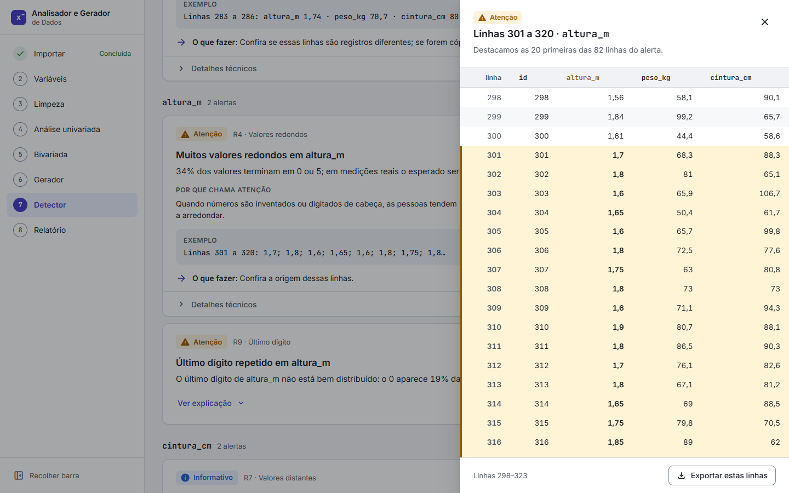

*Figura 16 — "Ver na tabela" do alerta R4: as linhas 301 a 320 destacadas, com contexto.*


*Figura 17 — `alturas_reais.txt`: nenhum alerta. "Isso não garante que os dados sejam reais, mas não vimos sinais comuns de dados artificiais."*

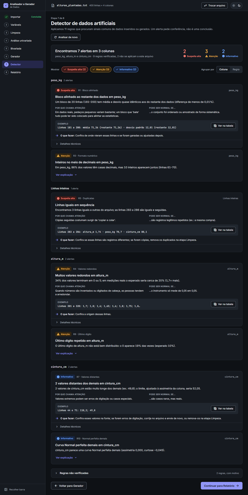

*Figura 18 — O detector no tema escuro.*

### 9.5 Demonstração com o Gerador

O Gerador e o Detector se completam: o caso mais difícil de pegar é gerar valores com a média e o desvio da própria coluna e anexá-los ao arquivo. Na demonstração, `alturas_reais.txt` (400 linhas, nenhum alerta) recebe 21 pesos gerados preservando as estatísticas (semente 7; como o peso desse arquivo não adere à Normal, o método é a KDE) com "Anexar ao arquivo atual". O detector passa a mostrar a R1 com suspeita alta: "Um bloco de 21 linhas (401–421) tem média e desvio quase idênticos aos do restante dos dados (diferença de 0,019%)." Os testes repetem a demonstração com várias sementes.

## 10. Relatório HTML

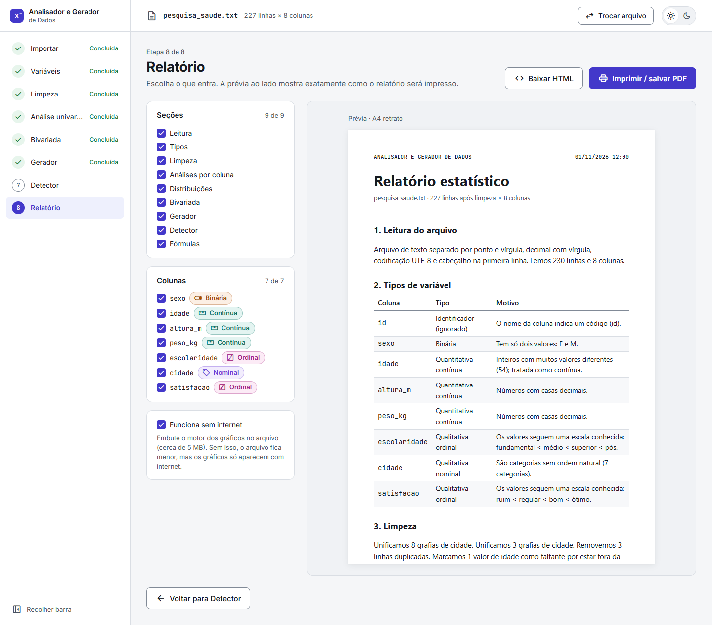

*Figura 19 — Relatório: seções e colunas escolhidas e a prévia em A4.*

A etapa 8 monta um relatório em HTML com 9 seções, que o usuário marca ou desmarca: **Leitura**, **Tipos**, **Limpeza**, **Análises por coluna**, **Distribuições**, **Bivariada**, **Gerador** (a última geração da sessão), **Detector** e **Fórmulas** (o apêndice, só com as fórmulas das seções incluídas, sem repetir). Também dá para escolher as colunas. A prévia ao lado é o próprio HTML.

- **Arquivo único:** o CSS vai dentro do arquivo. Com "Funciona sem internet", o motor dos gráficos (Plotly, ~5 MB) vai junto; sem a opção, o arquivo fica pequeno e os gráficos vêm da internet.
- **Fórmulas:** desenhadas com KaTeX; sem internet, aparece o texto de reserva de cada fórmula (por exemplo, `s² = Σ(xᵢ − x̄)² / (n − 1)`).
- **Impressão ("Imprimir / salvar PDF"):** cada seção começa numa página nova, os gráficos ocupam a largura toda, o texto de cada alerta não se divide entre páginas e o apêndice de fórmulas começa numa página própria.
- **Mesmos textos da tela:** rótulos, selos e frases são os mesmos ("Lemos 230 linhas e 8 colunas."), e as figuras são numeradas na ordem do documento.

O exemplo completo, gerado por script, está em `exemplo-relatorio.html` (Apêndice B).

## 11. Qualidade e testes

### Processo

O trabalho foi feito em marcos (M0 a M4), cada um dividido em blocos com plano, branch e pull request próprios, e cada mudança passa pelo CI antes de entrar na branch principal. As especificações por módulo ficam em `docs/specs/`, as decisões em `docs/decisions.md` e as mudanças de cada versão em `CHANGELOG.md`.

### Limites de qualidade verificados no CI

| Métrica | Limite | Ferramenta |
|---|---|---|
| Linhas por arquivo | ≤ 500 | teste de arquitetura (Python) · ESLint (TypeScript) |
| Complexidade ciclomática por função | ≤ 10 | ruff · ESLint |
| Complexidade cognitiva por função | ≤ 15 | complexipy · sonarjs |
| Aninhamento | ≤ 3 níveis | ruff · ESLint |
| Duplicação | 0 blocos de 50 tokens ou mais | jscpd |
| Tipos | sem erros, sem `any` | mypy (estrito) · TypeScript estrito |
| Cobertura de testes | ≥ 80% no backend | pytest-cov |

O CI tem 3 verificações: **backend** (ruff, formatação, mypy, complexipy e pytest), **frontend** (ESLint, Prettier, Vitest e build) e **duplicação** (jscpd).

### Testes

Números de 01/11/2026 (conferir na versão entregue):

| Parte | Testes | Destaques |
|---|---|---|
| Backend (pytest) | 1.212 testes · cobertura de 99% | Cada fórmula conferida com valores calculados à mão ou com o scipy; leitura de arquivos reais (XLSX com capa, JSON, TSV, CSV de 100 mil linhas); alertas falsos do detector (seção 9.3); os exemplos plantados disparam o que devem; os scripts refazem os arquivos versionados |
| Frontend (Vitest) | 710 testes | Telas, componentes e formatação pt-BR; acessibilidade das 8 telas com o axe; contraste dos tokens de cor nos dois temas (≥ 4,5:1 no texto) |

Desempenho (spec 00), medido com 10 mil linhas: análise de uma coluna em 0,02 a 0,11 s (meta: menos de 2 s) e detector completo em 0,7 a 0,9 s (meta: menos de 10 s).

## 12. Conclusão e limitações

O programa cobre todos os itens do enunciado: lê os cinco formatos, classifica as colunas e escolhe os cálculos e gráficos pelo tipo, limpa os dados com registro de cada ação, faz a análise descritiva completa com distribuições, assimetria e curtose, correlação, regressão e previsão, gera dados uni e bivariados realistas e reprodutíveis e aponta suspeitas de dados artificiais explicando o que mediu e por que marcou. Os dois lados se testam um ao outro: o Gerador cria o caso mais difícil para o Detector, e o Detector o encontra.

**Limitações conhecidas:**

- **R1 no meio do arquivo:** um bloco no meio só é encontrado com exatamente k linhas; o fim do arquivo (onde "Anexar" põe as linhas) é verificado com qualquer tamanho. Procurar todos os tamanhos em toda posição levaria minutos com 10 mil linhas, e procurar o começo com qualquer tamanho aumentava os alertas falsos; ficou de fora.
- **Colunas de pouca precisão:** com alturas em centímetros, um bloco gerado e arredondado não dispara a R1 (o acaso chega tão perto quanto ele); em pesos com uma casa decimal, dispara.
- **R11 no exemplo principal:** em `pesquisa_saude.txt` limpo, `altura_m` fica com atenção na fronteira (p = 0,0077), porque as primeiras linhas alternam F e M; a regra ficou como está.
- **Fórmulas sem internet:** no relatório baixado com "Funciona sem internet", as fórmulas aparecem no texto de reserva; embutir o KaTeX ficou de fora.
- **Escala:** o programa foi pensado para até ~100 mil linhas. Com 100 mil, a leitura leva de 5 a 11 s e o detector, de 11 a 17 s (a R1, com 1.000 embaralhamentos, é a mais lenta).
- **Estado em memória:** os dados ficam no servidor enquanto ele está aberto; reiniciar o servidor apaga a sessão (por escolha: uso local, um usuário, sem banco de dados).
- **Detector é indício, não prova:** cada alerta diz quando o padrão pode ser normal; a decisão final é de quem conhece a origem dos dados.

**Trabalhos futuros [o grupo pode ajustar]:** regressão múltipla, testes de hipótese para duas amostras, gráficos interativos no relatório sem internet e mais regras no detector (por exemplo, comparação entre grupos).

## Referências

> O grupo deve conferir as edições usadas e completar as datas de acesso.

- BRYS, G.; HUBERT, M.; STRUYF, A. A robust measure of skewness. *Journal of Computational and Graphical Statistics*, v. 13, n. 4, p. 996–1017, 2004.
- BUSSAB, W. O.; MORETTIN, P. A. *Estatística básica*. 9. ed. São Paulo: Saraiva, 2017.
- CRESPO, A. A. *Estatística fácil*. 19. ed. São Paulo: Saraiva, 2009.
- D'AGOSTINO, R. B.; PEARSON, E. S. Tests for departure from normality. *Biometrika*, v. 60, n. 3, p. 613–622, 1973.
- HUBERT, M.; VANDERVIEREN, E. An adjusted boxplot for skewed distributions. *Computational Statistics & Data Analysis*, v. 52, n. 12, p. 5186–5201, 2008.
- JOANES, D. N.; GILL, C. A. Comparing measures of sample skewness and kurtosis. *Journal of the Royal Statistical Society: Series D (The Statistician)*, v. 47, n. 1, p. 183–189, 1998.
- MONTGOMERY, D. C.; RUNGER, G. C. *Estatística aplicada e probabilidade para engenheiros*. 6. ed. Rio de Janeiro: LTC, 2016.
- NIGRINI, M. J. *Benford's Law: applications for forensic accounting, auditing, and fraud detection*. Hoboken: Wiley, 2012.
- SCOTT, D. W. *Multivariate density estimation: theory, practice, and visualization*. New York: Wiley, 1992.
- SHAPIRO, S. S.; WILK, M. B. An analysis of variance test for normality (complete samples). *Biometrika*, v. 52, n. 3/4, p. 591–611, 1965.
- STURGES, H. A. The choice of a class interval. *Journal of the American Statistical Association*, v. 21, n. 153, p. 65–66, 1926.
- TRIOLA, M. F. *Introdução à estatística*. 12. ed. Rio de Janeiro: LTC, 2017.
- TUKEY, J. W. *Exploratory data analysis*. Reading: Addison-Wesley, 1977.
- WALD, A.; WOLFOWITZ, J. On a test whether two samples are from the same population. *The Annals of Mathematical Statistics*, v. 11, n. 2, p. 147–162, 1940.
- NUMPY. *numpy.quantile*. Disponível em: https://numpy.org/doc/stable/reference/generated/numpy.quantile.html. Acesso em: **[preencher]**.
- SCIPY. *Statistical functions (scipy.stats)*. Disponível em: https://docs.scipy.org/doc/scipy/reference/stats.html. Acesso em: **[preencher]**.
- PANDAS. *pandas documentation*. Disponível em: https://pandas.pydata.org/docs/. Acesso em: **[preencher]**.
- PLOTLY. *Plotly Python graphing library*. Disponível em: https://plotly.com/python/. Acesso em: **[preencher]**.

## Apêndice A — Fórmulas

Todas as fórmulas do programa estão em [`formulas.md`](formulas.md), exportadas dos mesmos catálogos que a tela, o relatório HTML e os detalhes do detector usam (`backend/scripts/exportar_formulas.py`). Os grupos são: Frequências, Tendência central, Separatrizes, Dispersão, Forma e distribuições, Correlação e regressão, Gerador e Detector (uma lista por regra, com os símbolos no lugar dos valores de cada alerta).

## Apêndice B — Exemplo do relatório HTML

[`exemplo-relatorio.html`](exemplo-relatorio.html) é o relatório que o programa gera para `pesquisa_saude.txt` com a limpeza da seção 5, 500 valores de `peso_kg` gerados com a semente 42 e as 9 seções. Para ver os gráficos e as fórmulas, abra o arquivo no navegador (ele usa o Plotly e o KaTeX pela internet). O script `backend/scripts/exportar_relatorio_exemplo.py` refaz o arquivo.
